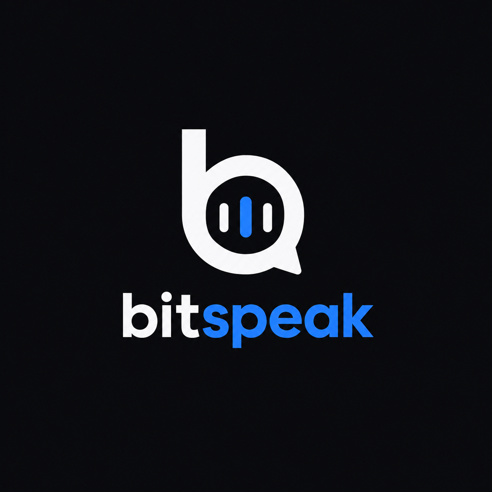

# BitSpeak

<p align="center">
  
</p>

<h3 align="center">Speak Binary Think Different</h3>

<p align="center">
  A lightweight binary encoding and file integrity toolkit for Node.js
</p>

<p align="center">
  
  
  
  
</p>

<p align="center">
  <a href="#features">Features</a> ·
  <a href="#installation">Installation</a> ·
  <a href="#usage">Usage</a> ·
  <a href="#roadmap">Roadmap</a>
</p>

---

## Overview

BitSpeak is a lightweight command line toolkit designed to encode decode verify and hash files directly from your terminal

Built with native Node.js APIs BitSpeak keeps its architecture simple and avoids unnecessary dependencies

Whether you are experimenting with binary representations validating file integrity or building terminal based workflows BitSpeak provides a clean foundation for file processing

## Features

### Binary Encoding

Convert file contents into the binary representation supported by BitSpeak

### File Decoding

Restore encoded files and compare the resulting output with the original content

### Integrity Verification

Verify whether a decoded file matches its original counterpart

### SHA 256 Hashing

Generate cryptographic digests for file integrity checks

### Zero Dependency Architecture

Use native Node.js functionality without relying on third party runtime packages

### Terminal First Workflow

Perform encoding decoding verification and hashing through a simple command line interface

### Developer Friendly Design

Keep file processing reproducible and easy to integrate into scripts and local development workflows

## Installation

### Requirements

- Node.js
- Git for repository cloning

### Clone the repository

```bash
git clone https://github.com/LattesGit/bitspeak.git
cd bitspeak
```

No external packages are required

## Usage

### Encode a file

```bash
node bitspeak.js --file encode app.js app.bits
```

### Decode a file

```bash
node bitspeak.js --file decode app.bits restored.js
```

### Verify file integrity

```bash
node bitspeak.js verify app.js restored.js
```

### Run the example

```bash
node examples/basic.js
```

### Run the test suite

```bash
node --test
```

## How It Works

```text
Original File
     |
     v
BitSpeak Encoder
     |
     v
Binary Representation
     |
     v
BitSpeak Decoder
     |
     v
Restored File
     |
     v
Integrity Verification
```

The encoding format defines how file content is represented and restored

The verification process checks whether the restored output matches the original content

SHA 256 hashing provides a compact digest that can help detect changes to file contents

## Security Model

BitSpeak is a file encoding and integrity toolkit rather than an encryption system

Encoding does not provide confidentiality

A SHA 256 digest can detect content differences when compared against a trusted digest

A hash alone does not prove who created a file or whether its source is trustworthy

Do not use BitSpeak encoding as a replacement for authenticated encryption or digital signatures

## Project Structure

```text
bitspeak
├── bitspeak.js
├── README.md
├── LICENSE
├── .gitignore
├── assets
│   └── logo.png
├── examples
│   └── basic.js
└── test
    └── bitspeak.test.js
```

## Development

BitSpeak uses the built in Node.js test runner

Run all tests with

```bash
node --test
```

Before submitting changes verify that encoding and decoding preserve file contents and that invalid inputs are handled correctly

## Roadmap

The following items are potential future improvements rather than claims about existing functionality

- [ ] Streaming support for large files
- [ ] Progress indicators for long running operations
- [ ] Recursive directory processing
- [ ] Batch encoding and decoding
- [ ] JSON output for automation
- [ ] Configurable output formats
- [ ] Improved error messages
- [ ] Benchmark suite for performance testing
- [ ] Cross platform compatibility tests
- [ ] Additional integrity verification workflows
- [ ] Release automation and versioned binaries
- [ ] Extended test coverage for malformed inputs

## Contributing

Contributions are welcome

1. Fork the repository
2. Create a feature branch
3. Implement your changes
4. Run the test suite
5. Submit a pull request

## License

BitSpeak is released under the MIT License

See the LICENSE file for the complete license terms

---

<p align="center">
  Built for developers who live in the terminal
</p>

<p align="center">
  <sub>BitSpeak · Encode · Decode · Verify · Hash</sub>
</p>
